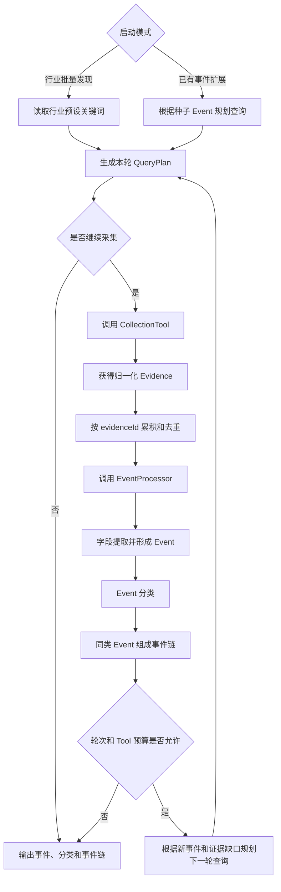

# SignalX 事件发现循环工作流

## 1. 会议结论

事件发现不能只执行一次“爬取后分析”，而应形成可以根据中间结果继续采集的循环。

当前确定两种启动方式：

### 模式一：行业批量发现

```text
行业预设关键词
→ 批量采集信息
→ 转换为 Event
→ Event 分类
→ 同类 Event 组成事件链
→ 判断是否继续补充采集
```

### 模式二：已有事件扩展

```text
已有相关 Event
→ 根据主体、产品、类型和证据缺口生成新查询
→ 再次采集
→ 转换、分类和成链
→ 判断是否继续扩展
```

两种模式最终使用同一个循环主体，只是第一轮查询的来源不同。

## 2. 总体架构



## 3. Agent 主体和外部模块的边界

### Agent 主体负责

- 支持两种启动模式；
- 管理当前轮次；
- 触发外部采集 Tool；
- 累积并去重 Evidence；
- 触发 Event 处理；
- 根据中间结果规划下一轮查询；
- 防止重复查询；
- 控制最大轮次和 Tool 调用次数；
- 保存每轮执行记录；
- 决定完成或停止。

### 外部采集模块负责

- 根据查询实际访问平台；
- 代理、Cookie、限速和反爬处理；
- 将平台结果归一化为 Evidence；
- 返回调用错误。

### 本模块的 EventProcessor 负责

- 从 Evidence 中提取事件字段；
- 将多条证据聚合为 Event；
- 对 Event 进行分类；
- 将同类或同故事线 Event 组成事件链。

Agent 主体通过接口调用这些模块，不依赖某个具体爬虫。默认实现为 `SignalXEventProcessor`，内部组合三个独立 Tool。

## 4. 代码结构

| 文件 | 作用 |
|---|---|
| `workflow.py` | 循环主体和外部依赖接口 |
| `workflow_models.py` | 工作流请求、状态、分类、事件链和结果模型 |
| `query_planner.py` | 初始查询和下一轮查询规划 |
| `prompts.py` | 查询规划 Prompt |
| `tools/event_extraction.py` | Evidence 聚合与 Event 字段抽取 Tool |
| `tools/event_classification.py` | 受控 Event 分类 Tool |
| `tools/event_chain.py` | 确定性事件链 Tool |
| `event_processor.py` | 三个 Tool 的组合处理器 |
| `competitor.py` | 对单个 Event 进行竞品分析 |
| `tests/test_event_tools.py` | 三个 Tool 及组合处理器测试 |
| `tests/test_workflow.py` | 循环、预算、去重和扩展模式测试 |
| `tests/test_query_planner.py` | 查询规划器测试 |

## 5. 工作流接口

### 5.1 CollectionTool

外部采集模块需要实现：

```python
class CollectionTool(Protocol):
    name: str

    def search(self, request: SearchRequest) -> list[Evidence]:
        ...
```

请求结构：

```json
{
  "query": "A 公司 AI 客服 价格",
  "industry": "企业服务",
  "roundIndex": 2,
  "limit": 20
}
```

采集 Tool 必须返回归一化后的 `Evidence`，不能直接返回平台私有原始结构。

### 5.2 EventProcessor

事件处理模块需要实现：

```python
class EventProcessor(Protocol):
    def process(self, evidence: list[Evidence]) -> EventProcessingResult:
        ...
```

输出包括：

```text
events
classifications
chains
```

### 5.3 QueryPlanner

查询规划模块需要实现：

```python
class QueryPlanner(Protocol):
    def initial_plan(self, request: WorkflowRequest) -> QueryPlan:
        ...

    def next_plan(
        self,
        request: WorkflowRequest,
        snapshot: EventProcessingResult,
        seen_queries: set[str],
        round_index: int,
    ) -> QueryPlan:
        ...
```

项目已经提供 `LLMQueryPlanner`：

- 模式一的第一轮直接使用行业预设关键词，不调用 LLM；
- 模式二的第一轮根据种子 Event 生成查询；
- 后续轮次根据 Event、分类、事件链和已执行查询判断是否继续。

## 6. 工作流输入

### 6.1 行业批量发现

```json
{
  "mode": "BULK_DISCOVERY",
  "industry": "智能客服",
  "presetKeywords": [
    "AI 客服",
    "客服机器人",
    "智能客服 新品"
  ],
  "maxRounds": 3,
  "maxToolCalls": 6,
  "perQueryLimit": 20
}
```

### 6.2 已有事件扩展

```json
{
  "mode": "EVENT_EXPANSION",
  "industry": "智能客服",
  "seedEvent": {
    "eventId": "evt_seed_001",
    "title": "A 公司发布 AI 客服产品",
    "summary": "当前只确认产品发布，价格和目标客户尚不明确。",
    "eventTypes": ["PRODUCT_LAUNCH"],
    "entities": ["A 公司"],
    "evidence": [
      {
        "evidenceId": "evd_seed_001",
        "title": "A 公司发布 AI 客服产品",
        "source": "新闻媒体"
      }
    ]
  },
  "maxRounds": 3,
  "maxToolCalls": 6,
  "perQueryLimit": 20
}
```

## 7. 循环状态

工作流持续维护：

```text
累计 Evidence
当前 Event 列表
Event 分类结果
当前事件链
已经执行的查询
已经使用的 Tool 调用次数
当前轮次
每轮执行记录
```

每轮完成后，查询规划器根据最新状态返回：

```json
{
  "shouldContinue": true,
  "queries": [
    "A 公司 AI 客服 官方价格",
    "A 公司 AI 客服 目标客户"
  ],
  "reason": "当前事件缺少价格和目标客户证据"
}
```

当证据已经充分时返回：

```json
{
  "shouldContinue": false,
  "queries": [],
  "reason": "事件主体、产品能力和市场定位已有独立来源支持"
}
```

## 8. 去重规则

### Evidence 去重

工作流使用 `evidenceId` 去重。同一条 Evidence 在不同查询中重复出现时，只保留第一次取得的对象。

### Query 去重

执行查询前会：

1. 去除首尾及重复空格；
2. 对英文进行大小写折叠；
3. 检查是否已在之前轮次执行；
4. 检查本轮 QueryPlan 内是否重复。

已经执行的查询不会再次调用 Tool，防止死循环和重复成本。

## 9. 停止条件

工作流可能因为以下原因停止：

| stopReason | 含义 |
|---|---|
| `COMPLETED` | 查询规划器判断现有信息已经足够 |
| `MAX_ROUNDS` | 达到最大循环轮次 |
| `TOOL_BUDGET_EXHAUSTED` | 达到最大 Tool 调用次数 |
| `NO_NEW_QUERIES` | 规划器只产生了已经执行过的查询 |
| `NO_EVIDENCE` | 采集后仍没有得到任何 Evidence |

最大轮次和 Tool 调用预算由 `WorkflowRequest` 强制控制，不能仅依赖 LLM 主动停止。

## 10. 每轮执行记录

每一轮保存：

```json
{
  "roundIndex": 2,
  "planReason": "补充价格信息",
  "toolCalls": [
    {
      "query": "A 公司 AI 客服 官方价格",
      "success": true,
      "resultCount": 5,
      "error": null
    }
  ],
  "newEvidenceCount": 3,
  "totalEvidenceCount": 12,
  "eventCount": 4,
  "chainCount": 1
}
```

该记录可以用于后续分析：

- 为什么进行了下一轮采集；
- 哪些查询没有结果；
- Tool 是否发生异常；
- 每轮增加了多少有效证据；
- 何时形成了稳定事件链；
- Agent 为什么停止。

## 11. 与竞品 Agent 的衔接

事件发现循环完成后，将符合竞品类别的 Event 交给现有 `CompetitorAgent`：

```python
workflow_result = discovery_workflow.run(request)

competitor_results = [
    competitor_agent.analyze(event)
    for event in workflow_result.events
    if "PRODUCT_LAUNCH" in event.event_types
]
```

完整链路变为：

```text
触发
→ 查询规划
→ 循环采集
→ Evidence
→ Event 提取
→ Event 分类
→ 事件链
→ CompetitorAgent
→ CompetitorAnalysis
```

## 12. 当前实现状态

已经完成：

- 双模式请求模型；
- 行业预设关键词启动；
- 种子 Event 扩展规划；
- 多轮采集循环；
- CollectionTool 注入接口；
- EventProcessor 注入接口；
- Evidence 去重；
- Query 去重；
- 最大轮次限制；
- Tool 调用预算；
- Tool 错误记录；
- 每轮状态记录；
- 事件、分类和事件链结果结构；
- 真实 Event 字段抽取 Tool；
- 受控 Event 分类 Tool；
- 确定性事件链 Tool；
- 可直接注入循环的 `SignalXEventProcessor`；
- 离线单元测试。

尚未接入：

- 真实爬虫对应的 CollectionTool 实现；
- 将现有爬虫输出转换为 Evidence；
- 工作流结果持久化；
- 生产环境可观测性。

## 13. 下一步联调任务

爬虫工作不在本模块范围内。下一阶段等爬虫组提供 `CollectionTool` 后进行端到端联调：

1. 校验爬虫输出能通过 `Evidence` Schema；
2. 将爬虫 Tool 和 `SignalXEventProcessor` 一起注入工作流；
3. 用一组真实行业关键词执行小规模闭环；
4. 保存每轮 Evidence、Event、分类和事件链结果用于人工评估。
