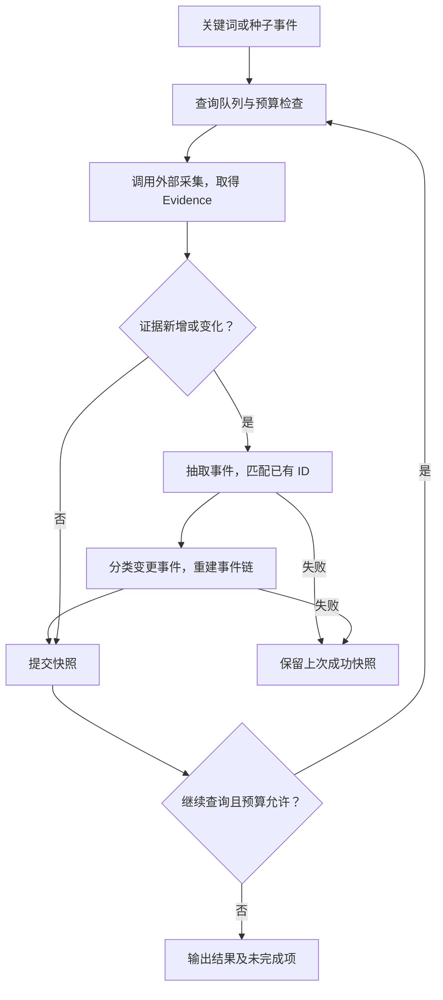

# Agent 工作流

入口：行业关键词（BULK_DISCOVERY）或种子事件（EVENT_EXPANSION）。Python 控制 Tool 顺序，模型负责抽取、分类及扩展查询规划。



预设关键词按队列执行，不因每轮上限丢弃。种子即使无需查询，也会完成事件处理；规划失败同样返回已有快照。

## 接口

| 组件 | 输入 → 输出 |
|---|---|
| CollectionTool.search | SearchRequest → Evidence 列表或含来源状态的 CollectionResult |
| EventExtractionTool.invoke | 增量 Evidence、existingEvents → 完整 Event 列表 |
| EventClassificationTool.invoke | 待分类 Event → 分类、标签、置信度 |
| EventChainTool.invoke | Event、分类 → 按主体和类别分组的事件链 |
| SignalXEventProcessor.process | 增量证据、previous、industry → 完整事件快照 |

字段定义见 [models.py](../agent/models.py)、[tool_models.py](../agent/tool_models.py) 和 [workflow_models.py](../agent/workflow_models.py)。

```python
from agent import DeepSeekLLM, EventDiscoveryWorkflow, LLMQueryPlanner, SignalXEventProcessor

llm = DeepSeekLLM()
workflow = EventDiscoveryWorkflow(
    collector=crawler_team_tool,  # 采集组提供
    processor=SignalXEventProcessor.from_llm(llm),
    planner=LLMQueryPlanner(llm),
)
result = workflow.run({
    "mode": "BULK_DISCOVERY",
    "industry": "智能客服",
    "presetKeywords": ["AI 客服", "客服机器人"],
})
```

## 关键规则

- 同 ID 的证据无变化则跳过；新增或变更证据进入抽取，仅重新分类相关事件。
- 新事件 ID 由证据原文锚点生成；matchedEventId 引用已有事件时保留旧 ID、合并证据。跨来源语义匹配仍需评测。
- 引用必须存在，anchor.quote 必须来自证据原文；非法模型输出默认最多尝试两次。
- 每个事件恰好一个主分类；事件链至少两个事件，不表示因果关系。
- 时间统一为 UTC；无时区按未知处理，排在已知时间之后。
- 处理成功才提交完整快照；失败不覆盖上次结果。文件演示在运行返回后落盘，不支持进程强杀后的自动恢复。

## 预算与结果

| 参数 | 默认值 | 限制 |
|---|---:|---|
| maxRounds | 3 | 循环轮数 |
| maxToolCalls | 6 | 采集调用次数，含失败 |
| maxLlmCalls | 24 | 模型调用次数，含失败和格式修正重试 |
| perRoundQueryLimit | 5 | 每轮查询数 |
| perQueryLimit | 20 | 每次接收的证据数 |

模型预算按每次 run() 独立计数，不是 token/金额上限。自定义组件须通过 `agent.llm.generate_json()` 调用才会纳入计数；工作流结束后的独立分析需另设预算。

结果包含 evidence、events、classifications、chains、rounds 和 stopReason。未完成时查看 pendingQueries、unprocessedEvidenceIds、errors；rounds 保存证据增量和成功快照。

## 单事件竞品分析与迁移

`CompetitorAgent.analyze(Event)`：校验输入 → 调用模型 → 校验结构与证据 ID → 补充固定元信息 → 输出 CompetitorAnalysis。引用存在不等于结论已得到语义验证。

从 v1.2 升级时：

- 自定义 process() 增加 previous、industry 关键字参数；输入改为增量，输出保留全部已有事件。
- 模型草稿增加必填 anchor、可选 matchedEventId；Event 增加可选 anchor。严格校验的下游模型需同步新增输出字段。
- 旧事件作为种子或 previous 传入以保留 ID；独立重抽原始数据可能生成新 ID。

## 爬虫与监测接入

[crawler_integration.py](../agent/crawler_integration.py) 连接采集桥和 `AgentTrigger`，启动命令见 [README](../README.md)。

- Evidence 新增 `snippet`（摘要）、`dedupKey`，与正文 `content` 分开；事件原文锚点可引用摘要。去重仍以稳定 `evidenceId` 为准。
- Event 保留 `alertMeta`；告警类型作为线索，主分类仍由 Agent 的受控枚举产生。
- 轮次采集记录新增 `status`、`sourceReports`、`droppedCount`；来源错误正文不进入 Agent 结果。
- 来源失败时有效证据继续处理；正常结束但采集不完整返回 `PARTIAL`，无可用事件则 `FAILED`。预算停止保留原停止原因。
