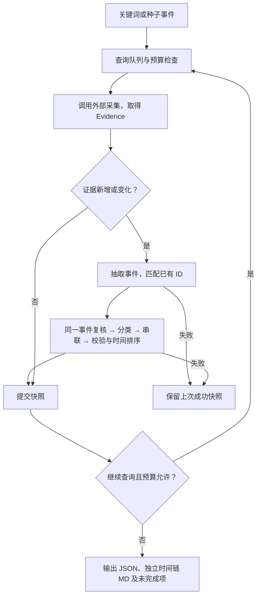

# Agent 工作流

入口：行业关键词（BULK_DISCOVERY）或种子事件（EVENT_EXPANSION）。Python 控制顺序和校验；DeepSeek 负责相关性、抽取、同一事件复核、分类、串联及查询规划。



预设关键词按队列执行，不因每轮上限丢弃。种子即使无需查询，也会完成事件处理；规划失败同样返回已有快照。

## 接口

| 组件 | 输入 → 输出 |
|---|---|
| CollectionTool.search | SearchRequest → Evidence 列表或含来源状态的 CollectionResult |
| EvidenceRelevanceTool.review | 种子事件、补充 Evidence → 相关／无关／不确定及原因 |
| EventExtractionTool.invoke | 增量 Evidence、existingEvents → 完整 Event 列表 |
| EventMergeTool.invoke | Event 列表 → 模型复核合并后的 Event，保留证据及 mergedEventIds |
| EventClassificationTool.invoke | 待分类 Event → 分类、标签、置信度 |
| EventChainTool.invoke | Event、分类、previousChains → 模型故事线、证据关系、时间线、未关联事件与待核实项 |
| SignalXEventProcessor.process | 增量证据、previous、industry → 完整事件快照 |

字段定义见 [models.py](../agent/models.py)、[tool_models.py](../agent/tool_models.py) 和 [workflow_models.py](../agent/workflow_models.py)。

```python
from agent import DeepSeekLLM, EventDiscoveryWorkflow, LLMQueryPlanner, SignalXEventProcessor

llm = DeepSeekLLM()
workflow = EventDiscoveryWorkflow(
    collector=crawler_team_tool,  # 采集组提供
    processor=SignalXEventProcessor.from_llm(llm),
    planner=LLMQueryPlanner(llm),
)
result = workflow.run({
    "mode": "BULK_DISCOVERY",
    "industry": "智能客服",
    "presetKeywords": ["AI 客服", "客服机器人"],
})
```

## 关键规则

- 同 ID 的证据无变化则跳过；新增或变更证据进入抽取，仅重新分类相关事件。
- 对接工厂为种子扩展启用相关性审查；只有相关证据进入处理，其他证据保留在 filteredEvidence，审查失败的输入保留在 unreviewedEvidence。所有审查调用计入模型额度。
- 主体按配置中的公司别名精确归一化；产品名不映射成公司，相似字符串不自动合并。
- 新事件 ID 由证据原文锚点生成；matchedEventId 引用已有事件时保留旧 ID、合并证据。跨来源语义匹配仍需评测。
- 引用必须存在；仅容忍连续空白和汉字之间的排版空格，回写当前证据的连续原文。词语、数字或否定词变化仍拒绝；重试反馈给出具体证据 ID 及原文。
- 抽取后由模型复核同一事件：合并置信度至少 0.85、引用各成员证据且时间相容；保留最早输入 ID 和 mergedEventIds。不同代产品及官宣、发布、预订、调价等不同动作不合并。
- 每个事件恰好一个主分类；DeepSeek 决定哪些事件关联，不按公司和类别硬分组。链至少两个事件；无关联依据允许空链，单事件不调用串联模型。
- 每条关系引用两端证据及连续原文；程序拦截未知 ID、自环、重复关系、断开的链、有向循环和已知时间倒置。语义及因果依据仍需抽查。
- 关系输出类型、理由、置信度及复核状态。日期范围不足以确定先后时标记 `needs_review`；待核实问题传给查询规划器并保留到最终结果。
- `timeline` 只从已有 Event 生成；新链类别为 `STORYLINE`。模型用 `matchedChainId` 延续旧链 ID，同一成员集改名也保持 ID。
- 时间从 timeAnchor 原文落地：完整带时区 ISO 时刻转 UTC；仅日期放入 eventDate（year／month／day）。相对时间和缺年份时间不推测；未知日期在 MD 单列。
- 处理成功才提交完整快照；失败不覆盖上次结果。文件演示在运行返回后落盘，不支持进程强杀后的自动恢复。

## 预算与结果

| 参数 | 默认值 | 限制 |
|---|---:|---|
| maxRounds | 3 | 循环轮数 |
| maxToolCalls | 6 | 采集调用次数，含失败 |
| maxLlmCalls | 24 | 模型调用次数，含失败和格式修正重试 |
| perRoundQueryLimit | 5 | 每轮查询数 |
| perQueryLimit | 20 | 每次接收的证据数 |
| maxNoProgressRounds | 1 | 连续无有效增量轮数；尚未搜索的预设关键词不跳过 |

模型预算按每次 run() 独立计数，包含同一事件复核、串联和重试，不是 token/金额上限。自定义组件须通过 `agent.llm.generate_json()` 调用才会纳入计数；工作流结束后的独立分析需另设预算。

结果包含 evidence、events、classifications、chains、rounds 和 stopReason。`chains` 内含 `relations` 和 `timeline`，`unlinkedEventIds` 保留未串联事件。CLI 同时导出 `timeline.md`，监测结果为 `<告警ID>.timeline.md`。未完成时查看 pendingQueries、unprocessedEvidenceIds、unresolvedQuestions、errors；rounds 保存证据增量和成功快照。

`NO_PROGRESS` 表示无有效增量，保留 `unresolvedQuestions` 和 `stopMessage`，不当作信息已核实。对接工厂每轮最多规划 2 个查询；单事件无需为了形成事件链继续搜索。

## 单事件竞品分析

`CompetitorAgent.analyze(Event)`：校验输入 → 调用模型 → 校验结构与证据 ID → 补充固定元信息 → 输出 CompetitorAnalysis。引用存在不等于结论已得到语义验证。

## 爬虫与监测接入

[crawler_integration.py](../agent/crawler_integration.py) 连接采集桥和 `AgentTrigger`，启动命令见 [README](../README.md)。

- Evidence 保留 `snippet`、`dedupKey`、`hasFullContent`、`sourceName`、`qualityWarnings`；仅摘要不填正文 `content`。证据去重仍以稳定 evidenceId 为准。
- Event 保留 `alertMeta`；告警类型作为线索，主分类仍由 Agent 的受控枚举产生。
- 轮次采集记录新增 `status`、`sourceReports`、`droppedCount`；来源错误正文不进入 Agent 结果。
- 来源失败时有效证据继续处理；正常结束但采集不完整返回 `PARTIAL`，无可用事件则 `FAILED`。预算停止保留原停止原因。
